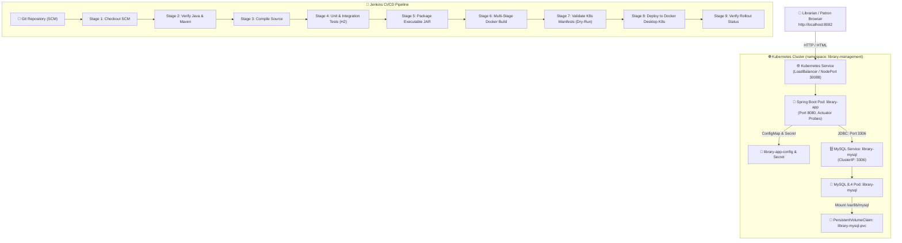

# Automated Library Management System (LibMaster OS)

An end-to-end, enterprise-grade **Automated Library Management System** built with **Spring Boot 3**, **Thymeleaf**, **MySQL 8.4**, **Docker**, **Kubernetes (Docker Desktop)**, and an automated declarative **Jenkins CI/CD Pipeline**.

---

## 1. Architecture Overview

LibMaster OS is designed according to cloud-native 12-factor application standards, separating configuration from code and leveraging container orchestration with automated health probing.



---

## 2. Technology Stack

| Component | Technology | Version | Purpose |
| :--- | :--- | :--- | :--- |
| **Backend Framework** | Spring Boot | 3.3.5 | Core MVC web application, REST actuator, DI container |
| **Language** | Java | 21 (bytecode target), compatible with JDK 21 - 26 | Modern Java language features |
| **Frontend UI** | Thymeleaf, HTML5, CSS3, Bootstrap 5 | 5.3.3 | Responsive modern dashboard, badges, modals |
| **Icons & Typography** | Bootstrap Icons, Plus Jakarta Sans | 1.11.3 | Clean, modern typography and visual indicators |
| **Database** | MySQL Server | 8.4 LTS | Persistent relational storage |
| **ORM / Persistence** | Spring Data JPA / Hibernate | 6.5.x | Object-relational mapping, custom JPQL queries |
| **Build Tool** | Apache Maven | 3.10.0 | Dependency management, build lifecycle |
| **Testing** | JUnit 5, Mockito, Spring Test, H2 | - | Isolated unit & integration testing |
| **Containerization** | Docker, Multi-Stage Dockerfile | - | Secure runtime image packaging with non-root user |
| **Compose** | Docker Compose | v2+ | Local multi-container development orchestration |
| **Orchestration** | Kubernetes (Docker Desktop) | v1.36+ | Namespace isolation, service discovery, PVC, probes |
| **CI/CD** | Jenkins Declarative Pipeline | - | Automated build, test, Docker image, K8s deployment |

---

## 3. Core Application Features

1. **Dashboard Overview**: Real-time counter metrics for total books, available copies, currently issued books, registered members, overdue alerts, and total accrued late fees.
2. **Book Catalog Management**:
   - Add new books, view catalog, edit details, and remove books.
   - Comprehensive search & filtering across Title, Author, Category, and ISBN.
   - Strict validation preventing duplicate ISBN entries.
   - Availability protection: Prevents deleting books that are actively loaned out.
3. **Patron Membership Directory**:
   - Register members with unique member codes, email, phone, and membership status (`ACTIVE`, `SUSPENDED`, `INACTIVE`).
   - Search patrons by name, email, or member code.
   - Dependency protection: Prevents deleting members who currently hold unreturned books.
4. **Circulation Desk (Book Issues & Returns)**:
   - Issue books only if available copies remain (> 0) and member account is `ACTIVE`.
   - Automatic decrement of available stock upon issue, and increment upon return.
   - Configurable loan periods (default: 14 days) and return date recording.
   - Automated overdue detection and configurable penalty calculation ($2.00 / day past due).
   - Dynamic return modal with automatic fee estimation.
5. **Repeatable Sample Data**:
   - Automatic seed database initializer on first startup without duplicates.
6. **Actuator Health Probes**:
   - Kubernetes liveness endpoint: `/actuator/health/liveness`
   - Kubernetes readiness endpoint: `/actuator/health/readiness`

---

## 4. Project Directory Structure

```text
Devops2/
├── .env.example                     # Environment template for Docker Compose & Local run
├── .gitignore                       # Git ignore rules for Maven, IDEs, and credentials
├── Dockerfile                       # Multi-stage production-hardened container build
├── docker-compose.yml               # Multi-container orchestration (App + MySQL 8.4)
├── Jenkinsfile                      # Declarative 9-stage CI/CD pipeline for Windows
├── pom.xml                          # Maven build file (Spring Boot 3.3.5, Java 21)
├── README.md                        # Complete technical and operations manual
├── k8s/                             # Kubernetes manifests for library-management
│   ├── namespace.yaml               # Dedicated Kubernetes namespace
│   ├── mysql-secret.yaml            # Database credentials secret
│   ├── configmap.yaml               # Cluster database URL and application port
│   ├── mysql-pvc.yaml               # Persistent Volume Claim for MySQL data (1Gi)
│   ├── mysql-deployment.yaml        # MySQL 8.4 deployment with volume mounts
│   ├── mysql-service.yaml           # Internal ClusterIP service (Port 3306)
│   ├── app-deployment.yaml          # Spring Boot deployment with Actuator probes
│   └── app-service.yaml             # LoadBalancer & NodePort (Port 8082, NodePort 30088)
├── sql/
│   └── init.sql                     # Repeatable MySQL 8.4 schema & sample seed data
└── src/
    ├── main/
    │   ├── java/com/library/management/
    │   │   ├── LibraryApplication.java           # Spring Boot main class
    │   │   ├── config/DataInitializer.java       # Idempotent database seeder
    │   │   ├── controller/                       # Web MVC Controllers
    │   │   ├── dto/                              # Data Transfer Objects
    │   │   ├── exception/                        # Custom domain exceptions
    │   │   ├── model/                            # JPA Entities (Book, Member, BookIssue)
    │   │   ├── repository/                       # Spring Data JPA Repositories
    │   │   └── service/                          # Business logic & validations
    │   └── resources/
    │       ├── application.properties            # Environment-driven configuration
    │       ├── static/                           # Custom CSS and JavaScript assets
    │       └── templates/                        # Thymeleaf views (dashboard, books, members, issues)
    └── test/
        ├── java/com/library/management/          # Unit & Integration test suite (15 tests)
        └── resources/application.properties      # Isolated H2 in-memory test configuration
```

---

## 5. Prerequisites

Before running the application or pipeline, verify the following tools on Windows 11:

1. **Java JDK 21+** (e.g. Oracle JDK 26 or Eclipse Temurin 21):
   ```powershell
   java -version
   javac -version
   ```
2. **Apache Maven 3.9+** (installed locally at `C:\Users\balad\tools\apache-maven-3.10.0` or in PATH):
   ```powershell
   mvn -version
   ```
3. **Docker Desktop**:
   - Ensure Docker Desktop is running in Windows taskbar.
   - Verify Docker CLI:
     ```powershell
     docker version
     ```
4. **Kubernetes (in Docker Desktop)**:
   - Enable Kubernetes in **Docker Desktop Settings -> Kubernetes -> Enable Kubernetes -> Apply & Restart**.
   - Verify cluster:
     ```powershell
     kubectl cluster-info
     kubectl get nodes
     ```

---

## 6. Running Locally with In-Memory H2 or Local MySQL

### Option A: Quick Local Run with In-Memory H2 (No Database Setup Needed)

To run the application locally without starting MySQL, activate the test profile or configure Spring Boot:

**In PowerShell:**
```powershell
# In project root: C:\Users\balad\Downloads\Devops2
$env:DB_URL="jdbc:h2:mem:librarydb;DB_CLOSE_DELAY=-1;MODE=MySQL"
$env:DB_USERNAME="sa"
$env:DB_PASSWORD=""
mvn spring-boot:run
```

**In Command Prompt (cmd.exe):**
```cmd
set DB_URL=jdbc:h2:mem:librarydb;DB_CLOSE_DELAY=-1;MODE=MySQL
set DB_USERNAME=sa
set DB_PASSWORD=
mvn spring-boot:run
```

Access in browser at: `http://localhost:8080/dashboard`

---

## 7. Running with Docker Compose (Recommended for Local Dev)

Docker Compose provisions MySQL 8.4 with persistent storage, executes `sql/init.sql`, and connects the Spring Boot container via the private network `library-network`.

### Step 1: Copy environment file

**In PowerShell:**
```powershell
Copy-Item .env.example .env
```

**In Command Prompt:**
```cmd
copy .env.example .env
```

*(Port 8082 is used for the app and port 3307 for MySQL to avoid conflicts with Jenkins or existing MySQL instances).*

### Step 2: Build and start the containers

```powershell
# Build image and start services in the background
docker compose up -d --build
```

### Step 3: Check container status and logs

```powershell
docker compose ps
docker compose logs -f library-app
```

### Step 4: Open application

Open your browser to:
👉 **`http://localhost:8082/dashboard`**

### Step 5: Stopping Docker Compose

```powershell
# Stop containers without losing data
docker compose down

# Stop and remove persistent database volume
docker compose down -v
```

---

## 8. Multi-Stage Dockerfile: Build & Run Manually

### Build the Docker image:

**In PowerShell / CMD:**
```powershell
docker build -t library-management-system:latest .
```

### Verify the created image:

```powershell
docker images library-management-system:latest
```

---

## 9. Kubernetes Deployment (Docker Desktop)

The Kubernetes manifests are configured for the `library-management` namespace. The application uses Kubernetes Service DNS (`library-mysql.library-management.svc.cluster.local:3306`) to communicate with MySQL internally.

### Step 1: Validate manifests with dry-run

```powershell
kubectl apply --dry-run=client -f k8s/
```

### Step 2: Deploy to Kubernetes in sequence

**In PowerShell or Command Prompt:**
```powershell
kubectl apply -f k8s/namespace.yaml
kubectl apply -f k8s/mysql-secret.yaml
kubectl apply -f k8s/configmap.yaml
kubectl apply -f k8s/mysql-pvc.yaml
kubectl apply -f k8s/mysql-service.yaml
kubectl apply -f k8s/mysql-deployment.yaml
kubectl apply -f k8s/app-service.yaml
kubectl apply -f k8s/app-deployment.yaml
```

### Step 3: Verify rollout status

```powershell
# Check rollout progress
kubectl rollout status deployment/library-mysql -n library-management --timeout=120s
kubectl rollout status deployment/library-app -n library-management --timeout=120s

# Inspect active pods, services, and PVCs
kubectl get pods,svc,pvc -n library-management
```

### Step 4: Access the Application

- **Primary Browser URL**:
  👉 **`http://localhost:8082/dashboard`**
  *(Configured via Kubernetes `LoadBalancer` on port 8082)*
- **Alternative NodePort URL**:
  👉 **`http://localhost:30088/dashboard`**
- **Actuator Health Endpoint**:
  👉 `http://localhost:8082/actuator/health`

### Step 5: Clean up Kubernetes resources

To tear down the Library Management deployment without affecting any other namespaces:

```powershell
kubectl delete namespace library-management
```

---

## 10. Jenkins CI/CD Pipeline Configuration

### Pipeline Overview
The repository contains a declarative `Jenkinsfile` at the root designed specifically for Windows environments where Jenkins runs as a Windows Service.

The pipeline executes 9 sequential stages:
1. **Checkout**: Retrieves source code from Git SCM.
2. **Verify Java and Maven**: Confirms JDK and Maven versions (`Maven-3.10`).
3. **Compile**: Runs `mvn -B clean compile`.
4. **Run Automated Tests**: Runs 15 unit and integration tests against isolated H2 database (`mvn -B test`).
5. **Package Executable JAR**: Generates the Spring Boot fat JAR (`mvn -B package -DskipTests`).
6. **Build Docker Image**: Builds and tags `library-management-system:latest`.
7. **Validate Kubernetes Manifests**: Runs `kubectl apply --dry-run=client -f k8s/`.
8. **Deploy to Local Kubernetes**: Applies all manifests to the `library-management` namespace.
9. **Verify Rollout Success**: Awaits deployment rollout and displays active pods and services.

### Setting up the Jenkins Job

1. Open Jenkins at: `http://localhost:8080`
2. Click **New Item**:
   - Item Name: `Library-Management-CI`
   - Type: **Pipeline** -> Click **OK**.
3. Under **Pipeline**:
   - Definition: Select **Pipeline script from SCM**.
   - SCM: Select **Git**.
   - Repository URL: Enter your GitHub repository URL (e.g. `https://github.com/<your-username>/Library-Management-System.git`) or local directory `file:///C:/Users/balad/Downloads/Devops2`.
   - Branch Specifier: `*/master` or `*/main`.
   - Script Path: `Jenkinsfile`.
4. Click **Save** and click **Build Now**.

### Troubleshooting Jenkins on Windows (LocalSystem Permissions)

When Jenkins runs as a Windows Service (`LocalSystem`), note these two tips:

1. **Docker CLI accessibility**:
   Ensure `C:\Users\balad\AppData\Local\Programs\DockerDesktop\resources\bin` is present in the Windows **System PATH** environment variable (not just the User PATH).
2. **Kubernetes Configuration (`.kube\config`)**:
   Docker Desktop stores the Kubernetes credentials under `C:\Users\balad\.kube\config`. If the Jenkins service reports `kubectl cluster-info` cannot connect, copy the config to the Jenkins profile:
   ```powershell
   New-Item -ItemType Directory -Force "C:\Windows\System32\config\systemprofile\.kube"
   Copy-Item "C:\Users\balad\.kube\config" "C:\Windows\System32\config\systemprofile\.kube\config"
   ```

---

## 11. Automated Testing Suite

The project includes 15 automated unit and integration tests executing under `mvn test`:

```powershell
mvn test
```

| Test Class | Scope | What It Validates |
| :--- | :--- | :--- |
| **`BookServiceTest`** | Unit Test (Mockito) | Unique ISBN creation, rejection of duplicate ISBN, protection against deleting books with active loans. |
| **`BookIssueServiceTest`** | Unit Test (Mockito) | Decrementing available copies on issue, preventing issue when available copies = 0, preventing issue to inactive members, incrementing copies on return, and computing exact late fee ($2.00 / day). |
| **`BookControllerTest`** | Integration Test (MockMvc) | GET `/books`, GET `/dashboard`, and Actuator `/actuator/health/liveness` and `/actuator/health/readiness` probes. |
| **`LibraryApplicationTests`** | Integration Test (SpringBootTest) | Complete Spring Boot context bootstrap with Spring Data JPA and HikariCP connection pooling. |

---

## 12. Troubleshooting & Diagnostic Commands

| Symptom | Diagnostic Command | Resolution |
| :--- | :--- | :--- |
| **Port conflict on 8080** | `netstat -ano \| findstr :8080` | Port 8080 is reserved by Jenkins. Use port **8082** (`http://localhost:8082`) for the Library app. |
| **Pods in `Pending` state** | `kubectl describe pod <pod-name> -n library-management` | Check if Docker Desktop Kubernetes has sufficient CPU/memory or if PVC is bound. |
| **Pod restarting (`CrashLoopBackOff`)** | `kubectl logs <pod-name> -n library-management --tail=50` | Verify MySQL has completed initialization. The app automatically recovers once MySQL is healthy. |
| **Database connection error** | `kubectl get svc -n library-management` | Ensure `library-mysql` service is active on port 3306. |
| **Inspect MySQL inside K8s** | `kubectl exec -it deployment/library-mysql -n library-management -- mysql -u root -prootpassword librarydb` | Direct SQL console access inside cluster. |

---

## 13. Summary of Live Deployment URL

| Target | Access Method | Port / URL |
| :--- | :--- | :--- |
| **Library Web Dashboard** | Browser | [http://localhost:8082/dashboard](http://localhost:8082/dashboard) |
| **Books Catalog** | Browser | [http://localhost:8082/books](http://localhost:8082/books) |
| **Circulation Desk** | Browser | [http://localhost:8082/issues](http://localhost:8082/issues) |
| **Patrons Directory** | Browser | [http://localhost:8082/members](http://localhost:8082/members) |
| **Kubernetes NodePort Access** | Browser | [http://localhost:30088/dashboard](http://localhost:30088/dashboard) |
| **Actuator Liveness Probe** | HTTP GET | [http://localhost:8082/actuator/health/liveness](http://localhost:8082/actuator/health/liveness) |
| **Actuator Readiness Probe** | HTTP GET | [http://localhost:8082/actuator/health/readiness](http://localhost:8082/actuator/health/readiness) |
| **Jenkins Dashboard** | Browser | [http://localhost:8080](http://localhost:8080) |
